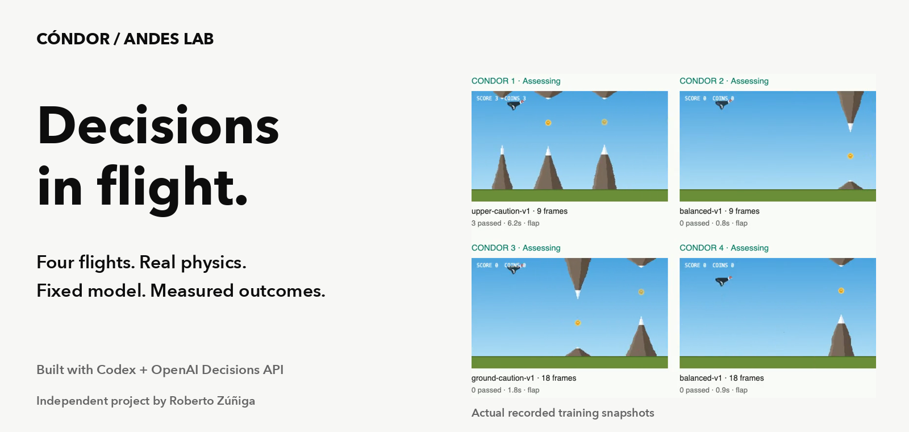

# Cóndor / Andes Lab

**An independent game-playing experiment built with Codex and the OpenAI Decisions API.**



Can fast action probabilities and outcome feedback help an AI play better? This
project tests that question in [Cóndor de los Andes](https://github.com/Robertzu43/condor-andes),
using the actual game physics, concurrent model assessments, recorded flights and
separate training and evaluation courses.

[Watch the 59-second overview](docs/media/condor-showcase.mp4) ·
[Full recordings](#recordings-and-evidence) ·
[Run locally](#run-locally) ·
[Method](docs/simulation-search.md) ·
[Draft X post](docs/social/x-post.txt)

**Checkpoint complete.** No experiments are scheduled or running automatically.
The game and API connection run locally; this repo does not expose an API key or
host a paid game-playing service.

## What the experiment does

1. Reads actual flight state, tap physics and visible mountain geometry.
2. Runs four isolated flights concurrently, with three model assessments per action.
3. Records choice probabilities, executed actions, timing, rewards and interruptions.
4. Selects a strategy on fully comparable training courses and freezes it.
5. Tests it against a fixed baseline on new courses, then checks normal-speed play.

The simulation executes `game.js`, including its original gravity, flap impulse,
collision silhouettes, coins and ULTRA behavior. OpenAI chooses every flap or wait.
Forecasts describe candidate paths; they never execute a safety override.

This is **strategy adaptation around a fixed hosted model**. Model weights are
unchanged. Choice probabilities are not survival probabilities or calibrated
success estimates. Parallel assessments are correlated opinions.

## What we found

| Experiment | Observation | Practical limit |
|---|---|---|
| Broad strategy search | One live pair: selected guidance passed 6 obstacles in 9.10 seconds; baseline passed 0 in 2.85 seconds. | One pair cannot establish reliable superiority. |
| Focused upper-caution refinement | The simulation winner averaged 3.19 seconds live, versus 4.31 for the existing instructions, losing 2 of 3 paired courses. | The refinement was not promoted. |

**The useful lesson: a simulation winner can lose live.** Frozen API waits and
continuous gameplay are different conditions. Future optimization should retain
the actual live clock and response delays during both training and evaluation.
The current standard instructions remain the default. No global optimum or
150-second successful flight is claimed.

The two bounded search campaigns made **16,273 calls** and completed **198 valid
flights**. Confirmed usage estimates total **$1.9665**, plus **$0.0105 uncertain**;
earlier manual trials are excluded. These are measured token-cost estimates,
not a final invoice. Interrupted attempts and regressions remain in the evidence.

## Recordings and evidence


- [59-second overview video](docs/media/condor-showcase.mp4): the method, an initial promising pair, and the later regression.
- [Broad search recording and results](docs/results/2026-10-13-search-results.md): six-minute recording, seven held-out pairs and usage accounting.
- [Refinement recording and results](docs/results/2026-10-13-refinement-results.md): nine candidates, eight held-out pairs and three normal-speed pairs.
- [Complete compressed decision and usage traces](docs/data/manifest.json): actual observations, both probabilities, applied/discarded answers and terminal outcomes.
- [Earlier experiments](docs/results/2026-10-12-results.md), [timing regression](docs/results/2026-10-13-cadence-results.md), and [delay-aware guidance](docs/results/2026-10-13-risk-results.md).

The overview uses real recorded footage at its original speed and clearly labeled
result cards. [Edit provenance](docs/social/video-edit.json) identifies source
clips and data. It contains no generated gameplay, invented model responses or
narration impersonating OpenAI.

## Run locally

Requires Node.js 22 or newer. There are no runtime dependencies.

```sh
npm run ai:mock
```

Open `http://127.0.0.1:8789`. MOCK is visibly labeled, always chooses wait, and
makes no OpenAI calls. For real play, copy `.env.example` to `.env`, set your own
`OPENAI_API_KEY` locally, and run `npm run ai`. The key stays server-side and is
ignored by Git. Start/Restart controls real play; Stop cancels it. Real calls
use `gpt-6-luna` through `/v1/decisions` and require separate API billing.

The read-only experiment display runs at `http://127.0.0.1:8790`:

```sh
node scripts/search-dashboard.mjs --data=/absolute/path/to/run-results
```

A search is a separate, explicit paid command with a shared hard spend guard;
opening a dashboard or this repo does not start one. See the
[search method](docs/simulation-search.md) before running a paid batch and the
[local usage guide](docs/local-usage.md) for controls, recording, budgets and exports.

```sh
npm test
npm run build
```

The suite covers real-game simulation, projection comparisons, fresh-answer
quorums, cancellation, reward separation, cost reservations and recording.
The build copies only the original public game's nine approved assets; it
excludes the local API server, credentials and experiment UI.

## Project and attribution

Created by Roberto Zúñiga; implemented with Codex. The copied game comes from
upstream commit `723a252`, with its original [MIT license](LICENSE) preserved.
The original public game and human leaderboard remain independent.

The presentation follows [OpenAI's design guidelines](https://openai.com/brand/)
with clear hierarchy, quiet neutral colors and secondary API attribution.
Cóndor / Andes Lab is an independent developer project, not an OpenAI product,
partnership or endorsement. No official logo or OpenAI Sans font is redistributed.
[Presentation notes](docs/brand.md) explain the typography and attribution.
