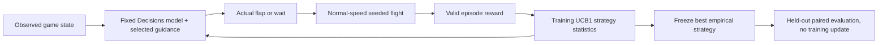

# Strategy learning around a fixed Decisions model

The local spectator adapts **flight guidance**, not hosted model weights. OpenAI Decisions still chooses every flap or wait. The public human game is independent. The hypothesis is that outcome feedback can select more effective guidance within a small time/request budget; a negative result remains a valid result.

Three server-owned strategies are versioned as `balanced-v1`, `upper-caution-v1`, and `ground-caution-v1`. Guidance configuration is `flight-guidance-v3`, including both-action 500 ms delay-stress estimates and overlap-only corridor margins; historical v1/v2 results remain separate. The server cadence is unchanged. The stress horizon starts at projected arrival and is not a guarantee against longer delays. Nearest-gap raw margins support planning; only overlap margins indicate immediate corridor risk. Provider evidence retains physics, hitbox, visible gaps, timing and previous action while omitting run metadata, progress and artwork; event observations remain complete. Only visible observations enter Decisions; course seeds and future obstacles are not provided as future information.

Reward is **10 × physical obstacles passed + 2 × physical coins collected + 0.1 × active flight seconds**, with seconds capped at 150. Physical counters survive the visual five-coin reset and ULTRA score multipliers. Preparation remains frozen and contributes no active-flight reward. Game over and a completed episode duration are valid outcomes. Cancel, hidden tab, resize, API errors, budget exhaustion and recording failures are interruptions with **null reward**, never a zero failure reward.

The episode-level UCB1 policy first visits each untried strategy in listed order. Then it maximizes `meanReward + sqrt(2 × ln(totalVisits) / visits)`, with stable listed-order ties. After training, evaluation freezes the strategy with the highest empirical mean, without the exploration bonus. Existing valid training history in the same context contributes to this choice. Contexts partition by model, configuration version, logical playfield width/height and mock flag; resizing never pools incompatible courses. Evaluation and baseline records never update these statistics.

Each batch attempts six training flights on seeds **101, 102, 103, 101, 102, 103**, followed by **balanced 1001, learned 1001, learned 1002, balanced 1002**. The held-out seeds are disjoint from training and the order is counterbalanced. Each episode is bounded to 15 seconds. Preparation and all episodes share **150 wall seconds and 750 requests**; one request runs at a time with at least 200 ms between server acceptance starts. Provider latency overlaps that interval: after each reply, the controller waits the server-reported remaining cooldown, or a full 200 ms if metadata is missing or invalid. Projections estimate the next action opportunity as max(200 ms, recent latency); initial preparation uses a 250 ms latency estimate while keeping arrival frozen. Transport jitter can extend these estimates. Errors stop the batch. A short or interrupted batch is reported as such.

The charts render stored episode records immediately, without making paid calls. Training shows actual reward and a trailing mean over the last three valid training flights (or fewer initially); crosses below the axis mark interruptions, without assigning rewards. Held-out comparison groups by experiment and seed, reports each side's valid counts and learned-minus-baseline reward difference, including zero or negative differences. The current geometry/model/configuration/mock context is explicit, with excluded records counted. MOCK data are scripted fixtures, never real evidence. Empty views stay empty.

The third chart is descriptive: one point per valid episode plots its reward against the mean returned probability of its **applied chosen actions**. Discarded or malformed decision distributions are excluded. This is not survival probability, calibration, causal action credit or evidence about unchosen actions. Decisions within one flight are correlated; later actions, geometry, course difficulty and latency confound association. Calibration requires a separately defined target and out-of-sample scoring. These six training flights and two held-out courses are a method smoke test, not evidence of general superiority or guaranteed improvement.

## Reproduce and inspect

1. Run `npm test` and `npm run build` with Node 22 or newer.
2. Run `npm run ai:mock`, open `http://127.0.0.1:8789`, and use Start experiment. MOCK is visibly marked; it makes no OpenAI calls.
3. For an authorized real batch, configure the server-only ignored `.env` as described in the README, restart with `npm run ai`, and explicitly select Start experiment. Recording is optional and captures strategy/phase across the continuous batch.
4. Download Export experiment JSON, and download the video when recording finalizes. Export includes observations, both returned probabilities, chosen action, timing, applied/discarded status, context, episode counters/reward, interruption reasons and statistics. Preserve unsuccessful outcomes and incomplete pairs.
5. Keep geometry fixed and the tab visible. Local storage retains history; incompatible or invalid episodes are ignored with a notice. Storage failure retains the current in-memory export. A clean browser profile gives a fresh-history batch; the existing-history behavior above is intentional.

Do not infer token costs when not measured. Larger or parallel batches require separate authorization and independent environments; the bounded demonstration does not establish reward gain per dollar. See [research hypothesis](research-hypothesis.md) for the claims and limits.

Cold preparation latency remains recorded, but the first live forecast starts with 250 ms; subsequent live replies supply measured latency.
