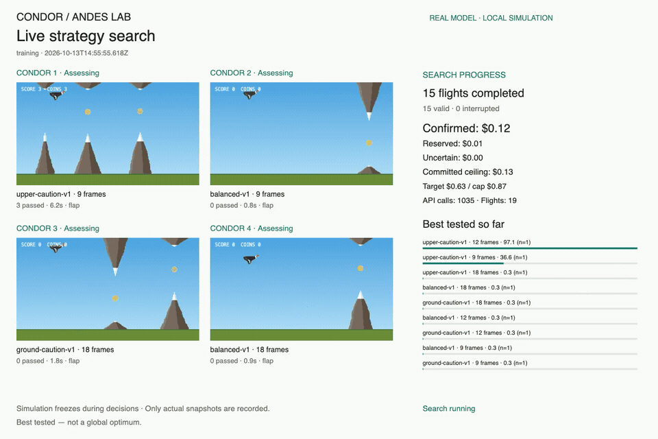

# Cóndor de los Andes — local AI spectator

This separate repository credits [robertzu43/condor-andes](https://github.com/robertzu43/condor-andes), copied from upstream commit `723a252` under its original MIT license (preserved in LICENSE). The original repository and public game are independent of this local experiment.

Node.js 22 or newer is required. There are no runtime dependencies.

```sh
npm run ai:mock
```

Open http://127.0.0.1:8789 to use the spectator. Mock mode always answers **wait**, makes no OpenAI calls, and is visibly marked MOCK in the page, recordings and logs. Direct bridge inspection is available at `/index.html#ai`.

For real decisions, copy `.env.example` to `.env`, set `OPENAI_API_KEY` locally, and run `npm run ai`. Restart the server after configuring the key. Never commit the key or paste it into chat. `/api/status` reports whether a key is configured without returning it. Real mode uses `gpt-6-luna` through OpenAI POST `/v1/decisions`. Missing credentials pause play; no automatic scripted fallback exists.

Control runs are limited to 150 seconds / 750 issued assessment requests. Three assessment lenses run concurrently per cohort; cohorts launch no faster than every 150 ms with at most six outstanding calls. Two fresh answers from the same cohort form one action using their mean flap/wait probabilities (ties wait). A flap invalidates pending assessments based on the old path. Stale answers cannot vote; repeated unusable cohorts pause the game. Death, stop, hidden pages, and resizing freeze AI control. AI play never submits to the human leaderboard. Real API play is verified in bounded experiments. Later v5 experiments reached six obstacles in one 9.1-second normal-speed flight; the focused refinement then regressed in paired live checks. A continuous long-duration demo is not validated. All measured versions and regressions are linked below.

```sh
npm test
npm run build
```

The public build remains an explicit game asset allowlist and excludes the local server, credentials, spectator and AI controller. Deployment scripts and the original Cloudflare binding have been removed to prevent accidental deployment to the upstream project. The original human score function remains credited source material; the local server does not serve it.

## Human game

Use Space or tap to flap. Collect five Inti coins to enter ULTRA ANDES. The copied game assets preserve the original physics, rendering and human input. Open `/index.html` for human play; `/index.html#ai` enables local structured controls.

## Spectator controls and exports

Start begins a normal-speed model-controlled run; Stop pauses it; Restart ends the current run and begins another. The panel displays actual choice probabilities and applied/discarded outcomes. During requests it explicitly displays Pending. The observation summary is the latest snapshot sent to the model, while game progress updates continuously. No hidden reasoning is shown.

Enable **Record this run** before Start. Recording captures the real game canvas and the live decision/progress panel together at 30 frames per second, with visible mock, pending, pause and error labels. A supported MediaRecorder codec is selected at runtime (usually WebM in Chrome); unsupported recording blocks the recorded run with an explanation. Stop, death or controller failure finalizes the video, then **Download video** saves it. **Export decisions** saves the complete run events, observations, returned probabilities, frames, timestamps, errors and mode as JSON. Restart replaces the previous run and exports, so download them first. Recording needs a visible browser tab; hiding the page ends control.

The local game permits its existing Google Fonts stylesheet and font origin to preserve its pixel lettering; the spectator uses available Avenir / Century Gothic / sans-serif fonts. No official OpenAI font is bundled. Chrome recording and video export were verified. The latest live run reported a 184 ms final response; latency varies.

Decision requests now overlap. The server allows up to six outstanding upstream calls and 30 admissions per rolling second; local capacity rejection is distinguished from OpenAI rate limiting. Guidance v5 runs immediate-collision, gap-approach and recovery assessments on the same snapshot and selected strategy, and averages the first two fresh valid answers. Individual votes and the contributing answers are exported separately from the applied action. These votes are correlated assessments, not independent evidence or calibrated survival estimates. Flight projections use max(150 ms, recent decision latency) plus a 500 ms stress horizon; actual jitter can exceed either. Exact visible-row contact evidence takes precedence over conservative rectangle warnings. Old guidance histories remain version-separated.

The first decision is a preparation phase: the game world remains frozen while OpenAI chooses the first flap or wait. The actual model answer resumes play and applies once; subsequent requests keep the simulation moving. Preparation counts toward the 150-second bound. Hidden pages or resizing cancel preparation.

The local AI spectator also offers **Start experiment**: six seeded training
flights (101–103 twice), followed by fixed balanced versus frozen learned guidance
on held-out seeds 1001 and 1002 in counterbalanced order. Each flight lasts at
most 15 seconds; preparation and all episodes share 150 seconds and 750 requests.
API failures, tab hiding, resize or Cancel interrupt the batch without learning a
failure reward. Learning is strategy selection around the fixed hosted model;
weights are unchanged and improvement is not guaranteed. Local records partition
by model, guidance version, logical geometry and mock mode. Export experiment JSON
includes complete observations, both choice probabilities, applied/discarded
outcomes, episode rewards and learning statistics. Storage failures retain current
records in memory. Selecting recording captures one continuous batch video.

The learning panel includes actual training rewards with a last-three-valid trailing
mean, held-out baseline/learned comparisons with counts and interruptions, and a
descriptive mean chosen-action probability versus episode reward view. Loaded
history renders without starting API calls. Mock and real results, geometry,
model and guidance version remain separate. Read the [learning method](learning-method.md)
for the reward, UCB1 rule, reproduction steps and limits. Choice probabilities
are not survival probabilities; a small batch may show no gain or regressions.

## Parallel simulation search

The local search runs four isolated copies of the **actual game code**, testing
nine candidates: three guidance strategies at 9, 12 or 18 frames between actions.
Each action averages three concurrent OpenAI assessments of the same visible
state. The simulation freezes during those requests, then advances the original
physics. This removes network delay from the strategy comparison; it is different
from normal-speed live control.

```sh
# Use a new absolute output directory; existing spend ledgers cannot be reset.
node scripts/search-dashboard.mjs --data=/absolute/path/to/search-results
node --env-file-if-exists=.env scripts/run-condor-search.mjs --output=/absolute/path/to/search-results
```

Open http://127.0.0.1:8790 to watch real snapshots, probabilities, ranking and
spend. The dashboard makes no model calls. **Record dashboard** captures all four
actual flight snapshots, rankings and the budget on one 1440 × 960 canvas. It
stops when the search ends and saves `training.webm` to the run directory;
**Download video** is a fallback. A new recording replaces that local video.
For a free smoke test,
replace the second command with `node scripts/run-condor-search.mjs --mock
--output=/absolute/path/to/new-mock-results` on one line.

The paid runner targets $1 of usage and permits at most $1.25, including pending
and uncertain reservations. It stops on unknown spend or provider errors without
retrying. All workers share one durable ledger. It ranks only training courses
completed by every candidate, freezes the winner, then evaluates against balanced
guidance on different courses. Short normal-speed checks transfer guidance only.
The result is the **best tested candidate**, not a global optimum or model-weight
training. Full traces, token usage, the frozen selection and final summary are
saved in the chosen directory. See [search method](simulation-search.md).

## Recorded parallel search

The [focused upper-caution refinement](results/2026-10-13-refinement-results.md)
used another $0.93 for nine candidates, four concurrent flights, eight held-out
pairs and three normal-speed pairs. Clearance instructions slightly improved
the simulation average but reduced mean live survival from 4.31 to 3.19 seconds.
The existing standard instructions remain the default. The full recording and
chart preserve that regression; no improvement is claimed from training alone.



[Full training recording](media/2026-10-13-training.mp4) ·
[Results, chart, cost and limitations](results/2026-10-13-search-results.md)

The $1-target search made 8,803 calls across two batches, with $1.0382 confirmed
usage and a $1.0487 conservative ceiling including uncertain calls. It selected
upper-caution at nine simulation frames. Seven held-out pairs averaged reward
23.91 versus 5.46 for balanced@12, including a regression on one course. A single
normal-speed guidance check passed six obstacles in 9.1 seconds versus none in
2.85 seconds for baseline. These are promising finite tests, not a global optimum
or model-weight training. The six-minute recording covers the second batch.

## Earlier measured learning showcase

An earlier delay-aware batch completed ten flights with 148 requests and 140 applied model answers. Average active flight time rose from 1.04 seconds in the timing-only batch to 2.85 seconds with delay-aware forecasts. Reward feedback selected upper-caution guidance; held-out runs passed one obstacle on one course and none on the other, while paired balanced baselines passed none. Two pairs are too few to claim reliable superiority, and v1 still has the highest held-out reward and longest measured flight.


[Latest results, all-version comparison and limitations](results/2026-10-13-risk-results.md) · [Compact measured trace](results/2026-10-13-risk-experiment.json) · [Learning method](learning-method.md)

Earlier results are preserved: [v1 baseline experiment](results/2026-10-12-results.md) and [v2 timing regression](results/2026-10-13-cadence-results.md). These experiments adapt strategy guidance around a fixed hosted model; probability calibration and model-weight training are separate work.

Manual Start and Restart use the empirical best strategy from valid training episodes matching the current model, guidance version, logical playfield dimensions and mock mode. Without matching training, they use `balanced-v1`. The strategy stays fixed for the flight; Restart reads the latest local records. Live decisions and recordings show the active strategy and phase, and manual JSON exports include the strategy and guidance version. Manual flights do not add training episodes. This selects prompt guidance; it does not train model weights.

The [game mechanics audit](game-mechanics.md) describes code-derived tap physics, silhouette collision forecasts, deterministic replay checks and exported action/death traces. Current guidance is v5; older learning is preserved separately.
