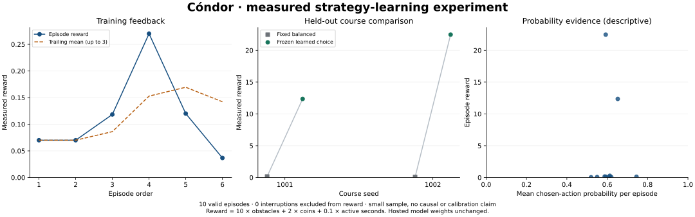

# First bounded strategy-learning experiment

The real Decisions connection completed all ten flights without a rate-limit error. The reward-selected `ground-caution-v1` strategy passed one and two obstacles on the two held-out courses; the fixed balanced baseline passed zero on both. This is a positive result from two paired courses, not evidence of reliable superiority or model-weight training.



## Conditions and evidence

- Observed October 12, 2026, in the local spectator; model `gpt-6-luna`, guidance `flight-guidance-v1`, logical playfield 384 × 216, real mode.
- Six training flights, then four frozen, counterbalanced evaluation flights. No previous real training records in this context. Mock history was excluded.
- 50 requests issued; 44 answers returned and applied. Six requests were aborted when their flights ended. No interrupted episodes, API errors or discarded returned decisions in this batch.
- Approximately 21.77 seconds from first episode start to final stop, including preparation. Total active flight time: 17.32 seconds. The shared ceiling remained 150 seconds / 750 requests.
- Returned-answer latency: mean 244.9 ms, median 213.1 ms, nearest-rank 95th percentile 445.8 ms. These exclude aborted requests. The first answer was held before takeoff, so its 711.7 ms latency was not an in-flight stall.
- Real cost was not measured. Request count is not token usage or billed cost.
- [Compact measured dataset](2026-10-12-experiment.json) retains every episode's metrics and every returned action, both choice probabilities and response latency. It omits raw request observations and start/request/stop events, and is explicitly not a full replay log. Its retained fields were checked against the browser data by canonical JSON checksum. Full episode events remain in the app's local history/export.

## All measured episodes

| Episode | Phase | Guidance | Seed | Obstacles | Coins | Active seconds | Reward |
|---|---|---|---:|---:|---:|---:|---:|
| 1 | Training | Balanced | 101 | 0 | 0 | 0.70 | 0.070 |
| 2 | Training | Upper caution | 102 | 0 | 0 | 0.70 | 0.070 |
| 3 | Training | Ground caution | 103 | 0 | 0 | 1.18 | 0.118 |
| 4 | Training | Ground caution | 101 | 0 | 0 | 2.70 | 0.270 |
| 5 | Training | Balanced | 102 | 0 | 0 | 1.20 | 0.120 |
| 6 | Training | Upper caution | 103 | 0 | 0 | 0.37 | 0.037 |
| 7 | Baseline | Balanced | 1001 | 0 | 0 | 1.55 | 0.155 |
| 8 | Frozen evaluation | Ground caution | 1001 | 1 | 1 | 3.53 | 12.353 |
| 9 | Frozen evaluation | Ground caution | 1002 | 2 | 1 | 4.68 | 22.468 |
| 10 | Baseline | Balanced | 1002 | 0 | 0 | 0.70 | 0.070 |

Best training mean: ground caution 0.194 (two flights), versus balanced 0.095 and upper caution 0.053 (two each). Held-out mean reward: 17.411 for the frozen selection versus 0.113 for baseline, a paired mean difference of +17.298. Training rewards did not rise monotonically; none of the six training flights passed an obstacle. The longest evaluation flight still ended after 4.68 active seconds.

## What this supports

The end-to-end mechanism works: collect rewards, update strategy statistics, freeze a selection, compare on separate courses and retain the actual probabilities and regressions. This batch is consistent with the selected guidance helping on these courses, but the small sample, uneven training-course allocation, model variability and changing latency prevent a strong causal claim. Neither calibration nor generalization beyond this setup was tested. Many moves from one flight are correlated observations, not independent experiments. Improvement on every flight is not expected.

Next evidence would come from multiple repeated, predeclared course pairs under matched latency conditions and a larger explicitly approved budget. That further experiment was not run here.

## Reproduce the figure

The game has no new runtime dependencies. Static report authoring optionally uses Python with Matplotlib:

```sh
python scripts/plot-learning.py docs/results/2026-10-12-experiment.json docs/results/2026-10-12-learning.svg
```

The plotting script refuses mock-only records, duplicate episodes, mixed contexts and inconsistent rewards. The probability plot is one point per episode using mean chosen-action probability; it is descriptive, not a survival calibration curve.

## Verification and recording

The app passes all 70 tests and its build. The optional plotting integration check covers 24 probability cases, and hardening its validation leaves the real-result PNG byte-identical.

The complete recorded mock batch finished ten episodes; cancelling a separate mock batch retained a null-reward interruption and finalized recording. The real batch also ended with “Recording ready.” Mobile layout at 390 CSS pixels had no horizontal overflow, and the real page reported no console errors. The in-app browser's download capture did not return a saved video file, so the real recording remains in its open app tab; this report does not claim a separately inspected real video file. Earlier standalone recording export tests are documented separately.
