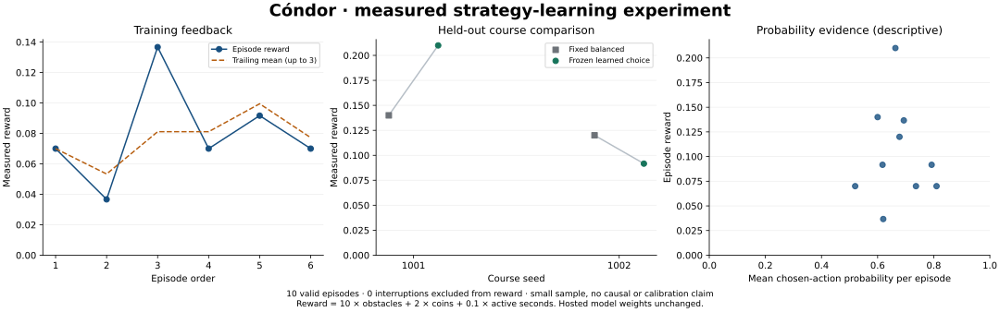

# Faster cadence, weaker flight outcomes

The server-coordinated cooldown removed an unnecessary delay. Median time between applied answers fell from 413.55 ms in the first measured batch to 203.15 ms in this batch. Flight outcomes regressed: all ten flights passed zero obstacles and ended at ground contact. Faster typical decisions alone did not produce better flight.



## Measured conditions

This batch used `gpt-6-luna`, `flight-guidance-v2`, the same 384 × 216 logical geometry, six training episodes and four held-out comparisons. Cadence-related instructions and projections changed together; these samples do not isolate a causal effect of timing alone. There were no earlier real v2 training records. v1 and mock records were retained but excluded from v2 statistics.

51 requests were issued, 42 answers returned and were applied, and nine pending requests were aborted when their flights ended. All ten episodes were valid game-over outcomes; no API error or rate-limit interruption occurred. First episode start to final stop was 18.90 seconds, including frozen preparation; total active flight time was 10.37 seconds. Recording finalized with “Recording ready.” The in-app browser's earlier download limitation remains; no saved real video file is claimed here.

Mean latency of returned answers was 298.51 ms, including held preparation answers as slow as 2,954.90 ms. Preparation latency does not expose the frozen bird to danger. Aborted requests have no completed latency, so this mean omits the slow calls that never returned. Nine flights ended with a request still pending; the two oldest pending requests were 706.10 and 714.40 ms old at death. Request age at death is a censored observation, not a completed latency or proof of which alternative action would succeed.

## All outcomes

| Episode | Phase | Strategy | Seed | Active seconds | Requests | Reward | Final request pending? | Final request age at death, ms |
|---|---|---|---:|---:|---:|---:|---|---:|
| 1 | Training | Balanced | 101 | 0.70 | 2 | 0.070 | Yes | 706.10 |
| 2 | Training | Upper caution | 102 | 0.37 | 2 | 0.037 | Yes | 373.30 |
| 3 | Training | Ground caution | 103 | 1.37 | 7 | 0.137 | Yes | 369.40 |
| 4 | Training | Ground caution | 101 | 0.70 | 4 | 0.070 | Yes | 120.00 |
| 5 | Training | Balanced | 102 | 0.92 | 5 | 0.092 | Yes | 315.50 |
| 6 | Training | Upper caution | 103 | 0.70 | 2 | 0.070 | Yes | 714.40 |
| 7 | Baseline | Balanced | 1001 | 1.40 | 8 | 0.140 | No | 191.10 |
| 8 | Frozen evaluation | Ground caution | 1001 | 2.10 | 10 | 0.210 | Yes | 424.90 |
| 9 | Frozen evaluation | Ground caution | 1002 | 0.92 | 5 | 0.092 | Yes | 319.00 |
| 10 | Baseline | Balanced | 1002 | 1.20 | 6 | 0.120 | Yes | 117.80 |

Selected ground-caution training mean was 0.1033. Held-out mean reward was 0.1508 versus 0.1300 for balanced guidance, a small +0.0208 difference driven entirely by active time. Both strategies passed zero obstacles. The earlier v1 selected guidance passed one and two; its different configuration, model variation, response latency and only two paired courses prevent a strong causal comparison.

## Reproduced forecasting failure

The final wait choice on held-out seed 1002 saw hitbox y=22.95, vy=0.05, height=14, ground y=192, gravity=0.35, and a recent answer latency of 173.80 ms. The nominal projection advanced 11 request frames, then 12 frames until the next estimated decision. It showed wait ending at y=120.60 with no ground contact. Continuing the same physics for a 500 ms response window reaches y=184.60 and ground contact.

The same input gave flap an upper gap margin of −68.50 pixels although the mountain center was still projected at x=330 at the next nominal decision, far from the bird at x=72. That margin described leaving a future vertical corridor; it did not describe an immediate collision. This is a confusing evidence format for a fast choice model.

The next correction therefore adds an explicit 500 ms delay-stress view for both actions, reports immediate conservative corridor risk only while horizontal bounds overlap, and shortens evidence/instructions. It preserves both choices and their probabilities without selecting an action locally. A cold answer received while the world was frozen should also remain distinct from the initial in-flight latency estimate. These corrections need a separate version and trial; they cannot establish that a 700 ms delay will be survivable.

## Evidence and reproduction

[Compact verified data](2026-10-13-cadence-experiment.json) retains each episode's metrics and all returned probabilities, actions, latencies and server cooldown values. Its retained episode/decision fields match the visible browser data by canonical JSON checksum. It omits raw observations and most lifecycle events; full logs remain in the app. Terminal-request ages are separate measured fields.

```sh
python scripts/plot-learning.py docs/results/2026-10-13-cadence-experiment.json docs/results/2026-10-13-cadence.svg
```

The cadence change passed 77 tests, the build and independent review. A recorded ten-episode mock batch also completed with no browser errors. No larger or parallel paid batch was run. Choice probabilities remain descriptive choice scores, not survival probabilities or independent per-action experiments.
