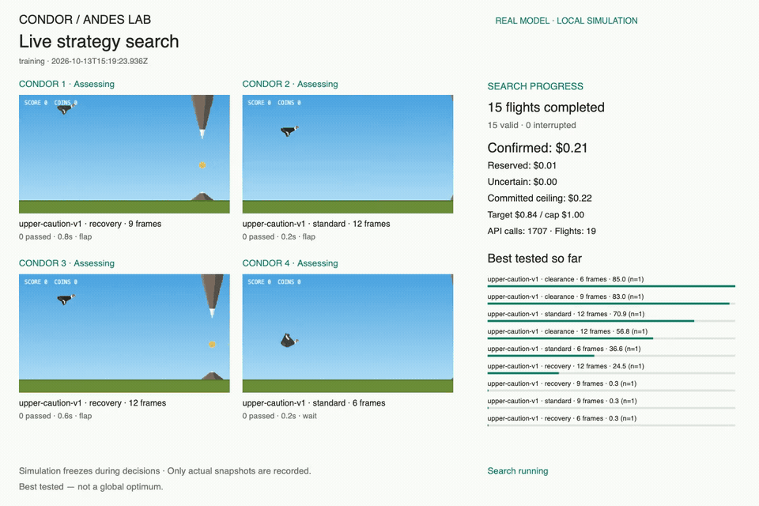
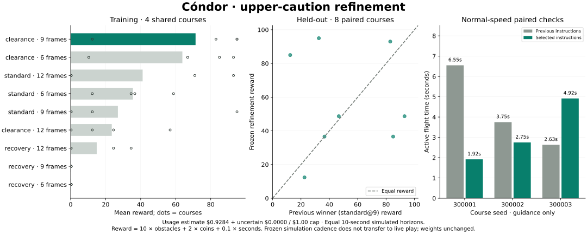

# Upper-caution refinement — 13 October 2026

**The refinement did not establish a better live strategy.** Clearance-focused
instructions at nine simulation frames won training and had a slightly higher
held-out simulation mean, but lost two of three normal-speed comparisons and
had lower mean live survival and reward. The existing standard instructions
remain the default; the selected simulation candidate was not promoted.

[Full 6-minute 48-second recording](../media/2026-10-13-refinement.mp4) ·
[Chart](2026-10-13-refinement.svg) ·
[Summary and cost](2026-10-13-refinement-summary.json) ·
[Compact episode evidence](2026-10-13-refinement-records.json) ·
[Method and reproduction](../simulation-search.md#focused-upper-caution-refinement)

## What was tested

Four actual-game VM flights ran concurrently. Each action used three concurrent
OpenAI assessments. Nine candidates combined the winning upper-caution strategy
with fixed standard, clearance and recovery instruction variants at 6, 9 and
12 frames per action. Every simulated flight had the same 600-frame / 10-second
horizon, within the 300-assessment limit even for the fastest candidate. The
game froze during model requests; physics, controls and collision rules stayed
the same. No hidden future course information was sent.

Training used new seeds starting at 1001. Only four courses completed by every
candidate (1001–1004) affected selection. The frozen training winner was
`upper-caution-v1/clearance@9`, mean reward 71.34, versus 26.98 for the previous
`upper-caution-v1/standard@9` candidate. The recovery variants were generally
poor in training. Extra unpaired training flights did not affect ranking.

Eight new held-out pairs used seeds 20001–20008 and counterbalanced order.
Evaluation did not alter the selected candidate. Normal-speed checks then
compared the selected **instructions** against standard instructions on three
additional paired seeds, keeping existing live timing and quorum behavior.
Simulated action cadence did not transfer to those live checks.

## Results

| Held-out simulation mean, eight pairs | Previous standard@9 | Clearance@9 |
|---|---:|---:|
| Reward | 51.46 | 56.99 |
| Obstacles passed | 4.38 | 4.75 |
| Active seconds | 7.11 | 7.40 |

The paired mean reward difference was **+5.53**. Clearance passed more obstacles
on three courses, fewer on three and tied on two. Large gains on seeds 20001 and
20003 offset substantial regressions on 20004 and 20008. This small finite
sample does not establish general superiority.

| Normal-speed course | Standard seconds / obstacles | Clearance seconds / obstacles |
|---|---:|---:|
| 300001 | 6.55 / 4 | 1.92 / 0 |
| 300002 | 3.75 / 1 | 2.75 / 0 |
| 300003 | 2.63 / 0 | 4.92 / 2 |
| Mean | **4.31 / 1.67** | **3.19 / 0.67** |

Clearance regressed on the first two live courses and improved on the third.
Mean live reward was 7.65 versus 18.43 for standard instructions. Its first live
flight ended on the ground; all other live checks ended on rock. The ground
failure followed a final wait at frame 88 and death at frame 115; its last flap
was frame 70. These are observed actions, not evidence that one probability was
miscalibrated or that network delay alone caused the failure.

The practical finding is a **simulation-to-live mismatch**: a prompt selected
under frozen requests was not better under continuous movement. Future
optimization should train and evaluate under the actual live clock and response
delays, retaining fixed-course comparisons. More concurrent calls alone do not
establish better actions, and hosted model weights were never trained.

## Budget, recording and validation

This separate authorized experiment used **$0.9283633** of usage-derived cost
against its **$1 maximum**, with **7,470 successful upstream calls**, no unknown
usage and no pending reservations. It completed 62 valid flights: 40 training,
16 held-out and six live checks. Four training flights ended at the phase budget
boundary and received no reward. The prior experiment's spending is separate.
The bounded evaluation and three live pairs finished before the cap; no padding
calls were made to spend the remaining seven cents.

The estimate reconciles with per-call uncached token usage at
[official Decisions pricing](https://developers.openai.com/api/docs/guides/decisions#pricing-and-availability);
it is not a final billing invoice. Local outputs retain complete observations,
probabilities, action timing, original WebM and sanitized usage records. The
repository contains compact results, the chart, preview and full MP4. The preview
is a 12-second excerpt from 90 seconds into the actual recording.

Validation: all 121 tests and the public nine-asset build pass; independent review
found no blocker. The H.264 recording fully decodes at 1440 × 960, duration
408.20 seconds. Its settled game-over frame and result chart were visually
inspected. No calls were made after the experiment completed. The original public
game is unchanged, with no automatic live-policy promotion or global-optimum
claim.
