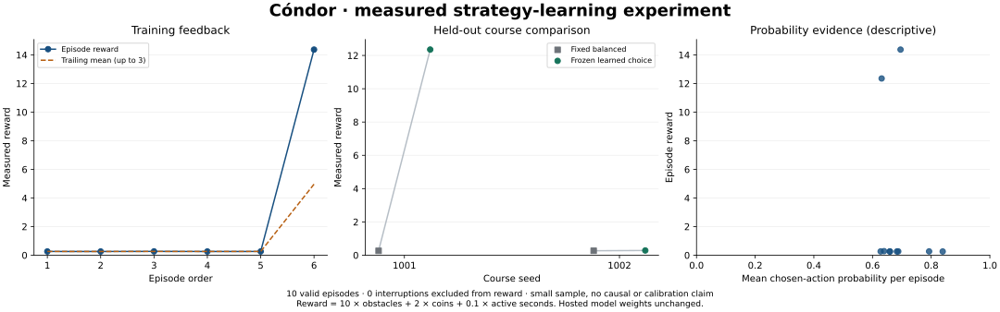

# Delay-aware forecasts: improved stability, mixed generalization

The v3 batch averaged 2.85 active seconds per flight, compared with 1.04 in the preceding timing-only v2 batch. The longest flight was 3.72 seconds. Outcome feedback selected upper-caution guidance; its frozen held-out runs passed one obstacle on seed 1001 and zero on seed 1002, versus zero on both paired balanced baselines. This is a recovery from the v2 regression, not proof of reliable improvement or the strongest held-out result observed so far.



## Changes and conditions

- Same `gpt-6-luna` model, normal game physics and server-coordinated cadence; each flap/wait remains the returned model choice. [Official Decisions documentation](https://developers.openai.com/api/docs/guides/decisions) describes this fixed-choice answer contract.
- `flight-guidance-v3` adds nominal and 500 ms delay-stress projections for both actions. Corridor risk uses horizontal overlap with an envelope derived from visible ridge widths. A distant gap's planning margin is distinct from immediate corridor clearance.
- Held first-answer latency remains recorded, while the first live forecast starts at 250 ms. Full observations remain in app events; provider evidence omits run metadata and artwork. These changes were bundled, so this experiment does not identify which individual change caused the observed difference.
- Same 384 × 216 geometry, six training flights followed by four counterbalanced paired comparisons. No prior real v3 history; older versions and mocks were excluded.
- One bounded recorded batch: 148 issued requests, 141 returned answers, 140 applied. One answer was discarded because the game had ended; seven other requests were aborted at flight end. All ten episodes ended normally with game-over rewards; no API or rate-limit interruption.
- First episode start to final stop: 32.27 seconds, including preparation; total active time 28.50 seconds. Mean returned-answer latency 184.71 ms; median interval between applied answers 207.55 ms. Aborted requests have no completed latency and are excluded from the mean.

## Every episode

| Episode | Phase | Strategy | Seed | Obstacles | Coins | Active seconds | Requests | Reward |
|---|---|---|---:|---:|---:|---:|---:|---:|
| 1 | Training | Balanced | 101 | 0 | 0 | 2.62 | 13 | 0.262 |
| 2 | Training | Upper caution | 102 | 0 | 0 | 2.60 | 13 | 0.260 |
| 3 | Training | Ground caution | 103 | 0 | 0 | 2.67 | 14 | 0.267 |
| 4 | Training | Ground caution | 101 | 0 | 0 | 2.60 | 14 | 0.260 |
| 5 | Training | Balanced | 102 | 0 | 0 | 2.62 | 14 | 0.262 |
| 6 | Training | Upper caution | 103 | 1 | 2 | 3.72 | 19 | 14.372 |
| 7 | Baseline | Balanced | 1001 | 0 | 0 | 2.65 | 14 | 0.265 |
| 8 | Frozen evaluation | Upper caution | 1001 | 1 | 1 | 3.53 | 18 | 12.353 |
| 9 | Frozen evaluation | Upper caution | 1002 | 0 | 0 | 2.83 | 15 | 0.283 |
| 10 | Baseline | Balanced | 1002 | 0 | 0 | 2.67 | 14 | 0.267 |

Upper-caution training mean was 7.3158 (two episodes), versus balanced 0.2617 and ground caution 0.2633 (two each). One successful training episode dominates that choice; training strategies did not all see every training course. Frozen held-out mean reward was 6.3183 versus 0.2658 baseline, a paired mean difference of +6.0525. Only two paired courses were tested.

## All versions remain visible

| Configuration | Mean active seconds, all 10 flights | Longest flight | Selected held-out obstacles by seed 1001 / 1002 | Selected held-out mean reward |
|---|---:|---:|---|---:|
| [v1: original forecasts](2026-10-12-results.md) | 1.73 | 4.68 | 1 / 2 | 17.411 |
| [v2: overlapped cooldown](2026-10-13-cadence-results.md) | 1.04 | 2.10 | 0 / 0 | 0.151 |
| v3: delay-aware evidence | 2.85 | 3.72 | 1 / 0 | 6.318 |

The response-latency distributions, instructions and projections differ between batches. This is a descriptive comparison of small samples, not a controlled causal estimate. v3 improved average early survival over both previous batches but did not surpass v1's longest flight or its held-out obstacle/reward result. We do not have a continuous 150-second flight. Several v3 strategies still flap repeatedly into the first obstacle, so ground avoidance alone does not solve gap approach planning.

## Inspect and reproduce

[Verified compact trace](2026-10-13-risk-experiment.json) retains every episode's metrics, every returned choice distribution, action, outcome, applied frame, warmup flag and server cooldown. Answer/mean latencies are explicitly rounded to 0.1 ms. Canonical JSON checksums confirm retained fields match the visible browser export after that rounding. Raw request observations and lifecycle events are omitted; the full logs remain in the app's local export. The probability chart uses applied decisions only and makes no calibration or causal-credit claim.

```sh
python scripts/plot-learning.py docs/results/2026-10-13-risk-experiment.json docs/results/2026-10-13-risk.svg
```

All 81 application tests and the build pass. Independent review approved the changes and the ridge-envelope correction. The mock batch and real batch finalized recording; the real recording remains available in its open app tab. No separately downloaded real video was inspected because of the in-app browser's previously recorded download limitation. Hosted model weights were unchanged.

After the real trial, a spectator-label correction was verified with a deliberately delayed 650 ms MOCK reply: game over clears the pending label, identifies the last answer and ended request, removes the green applied marker, and finalizes recording without browser errors. This display-only check made no paid calls and did not modify the measured flight trace. The real backend was restored afterward.
