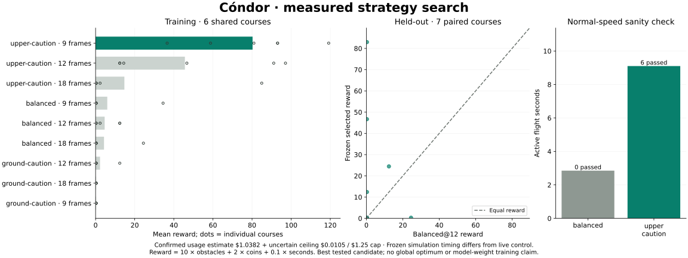

# Parallel search and recorded dashboard — 13 October 2026

The search selected **upper-caution-v1 at nine frames per action** among nine
candidates. Seven held-out simulation pairs averaged reward 23.91 for the
selected candidate versus 5.46 for balanced@12, a difference of +18.46. This is
a finite candidate comparison, not a global optimum or a weight-training result.

[Watch/download the six-minute MP4](../media/2026-10-13-training.mp4) ·
[Measured chart](2026-10-13-search.svg) ·
[Combined usage and outcomes](2026-10-13-search-summary.json) ·
[Second-batch compact episode records](2026-10-13-search-records.json) ·
[Reproduction and method](../simulation-search.md)

The recording shows actual four-slot flight snapshots, rankings, phase, counts
and cost. It covers the second batch from preparation through evaluation and
normal-speed checks. The earlier batch was not video-recorded; its decision
traces remain local and its outcomes and cost are included in the summary.
The preview is a 12-second excerpt starting 60 seconds into the video. A settled
terminal snapshot is appended at the end, restored from the real stop event:
late discarded answers had overwritten the dashboard tile after game-over.
The runner now preserves terminal tiles. No flight frames were invented.

## Usage and interruptions

Across both batches: **8,803 upstream calls**, 136 valid flights and 43
interrupted attempts. Confirmed usage-derived cost is **$1.0381745**, plus
**$0.0105447** reserved for unknown usage, for a conservative total ceiling of
**$1.0487192**, below the approved $1.25 cap. No calls remain pending. The $1
confirmed-usage target was reached. The estimate uses actual uncached token
counts at [official Decisions pricing](https://developers.openai.com/api/docs/guides/decisions#pricing-and-availability),
not a final invoice or the dashboard balance.

The first batch stopped on HTTP 503 after 3,150 successful responses. Twelve
dispatched requests lacked usage (one 503 plus canceled pending requests); their
full reservations remain uncertain. It had 53 valid and four interrupted flights,
with no evaluation. The next batch's guard was reduced to $0.8679824 and its
confirmed target to $0.6285271, preserving the original combined cap.

The second batch made 5,641 successful requests with no API error. Its 83 valid
flights comprise 67 training, 14 held-out and two normal-speed checks. Thirty-nine
attempts ended at the training phase allowance, including short or empty attempts
while pending reservations settled. All were excluded from rewards and ranking.
A regression test now prevents workers starting replacement flights after a
phase closes; the original observations are retained rather than cleaned away.

## Comparison

Ranking uses only seeds 101–106 completed by **every** candidate: six courses
per candidate. The selected candidate's training mean reward was 80.27, versus
4.64 for balanced@12. Unpaired extra training results do not influence selection.
The winner was frozen before held-out seeds 10001–10007 were evaluated.

| Held-out seed | Balanced@12 reward | Selected@9 reward | Difference |
|---|---:|---:|---:|
| 10001 | 0.26 | 46.70 | +46.44 |
| 10002 | 0.28 | 12.40 | +12.12 |
| 10003 | 0.26 | 0.28 | +0.01 |
| 10004 | 0.27 | 82.98 | +82.71 |
| 10005 | 24.51 | 0.29 | −24.22 |
| 10006 | 12.36 | 24.46 | +12.10 |
| 10007 | 0.25 | 0.28 | +0.02 |

Selected guidance averaged two obstacles and 4.82 active seconds per held-out
flight; baseline averaged 0.43 obstacles and 3.13 seconds. The selected candidate
regressed on seed 10005. Some tiny positive reward differences reflect survival
time only, not obstacles passed. Seven courses with one flight per candidate do
not establish reliable general superiority. Prompt and action interval change
together; this comparison does not isolate their separate effects.

The separate normal-speed sanity check kept live v5 timing and quorum rules:

| Guidance | Active seconds | Obstacles passed | Ending |
|---|---:|---:|---|
| balanced-v1 | 2.85 | 0 | Rock |
| upper-caution-v1 | 9.10 | 6 | Rock |

Both used seed 200001. This single live pair is promising but has no replication.
It transfers **guidance only**, not nine-frame frozen simulation timing. The best
simulation flight passed ten obstacles over 11.82 seconds. No 150-second flight,
probability calibration, model-weight learning or global optimality is proven.
Original public gameplay and leaderboard remain untouched.

Validation: 117 automated tests and the nine-asset public build pass. The MP4
decodes as H.264 at 1440 × 960, duration 363.73 seconds; training and settled
ending frames were visually inspected. Complete raw traces and original WebM
clips remain in local outputs; GitHub contains the compact evidence and video.
